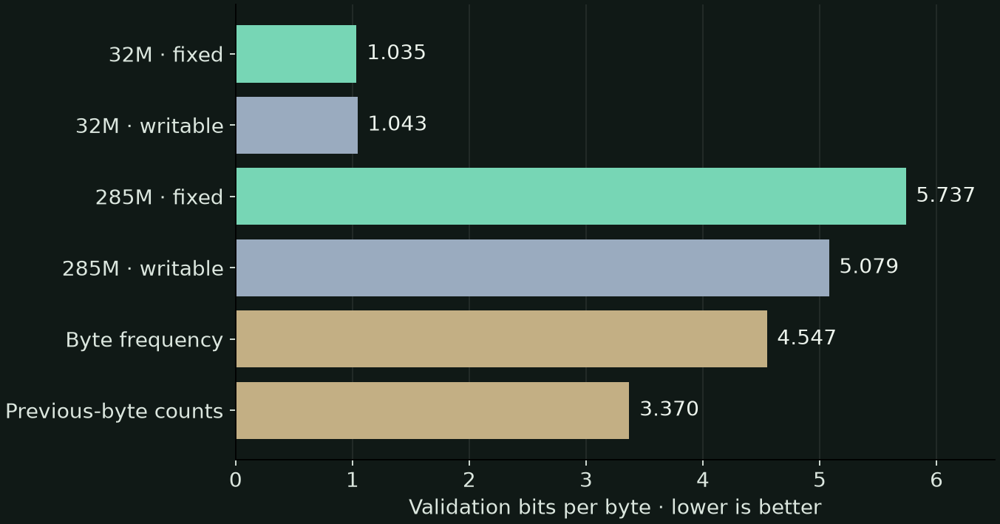

# Both 285M Python models missed the learning threshold at the original rate

After 4,096 matched updates on CPython, the 285M-parameter model with 192 protected coordinates scored 5.737 bits per byte. Its fully writable control scored 5.079. Both assigned lower probability to the observed validation bytes than a predictor using training-set byte frequencies alone (4.547 bits per byte). The smaller 32M models had scored 1.035 and 1.043 on the same windows. The wider comparison stopped at its prespecified validation gate. A separate lower-learning-rate experiment is queued to test whether the wide models can learn under otherwise identical conditions.

## What changed with width

Both models have ten transformer blocks. The first two produce a per-byte state. In the fixed arm, one eighth of that state passes unchanged through seven more blocks. Each intervening block can read it. The writable control can update it. The pair shares its starting weights within each width, including initially zero writes to the designated coordinates. Width rose from 512 to 1,536, and the protected slice grew from 64 to 192. We held training order, optimizer, warmup, batch size and 33,554,432 training bytes per arm fixed. The larger models used about nine times as many parameters and more computation per training byte. The two wide fits and evaluation ran in about 26 minutes on the Studio. [Benchmark protocol](../LARGE_FIXED.md) · [Pinned receipt and per-window scores](../results/large-original-mid)

| Predictor | Validation bits per byte | Correct next-byte predictions |
|---|---:|---:|
| 32M fixed | 1.03549 | 79.80% |
| 32M writable | 1.04253 | 79.70% |
| 285M fixed | 5.73704 | 13.20% |
| 285M writable | 5.07911 | 29.53% |
| Training-set byte frequencies | 4.54745 | 28.92% |
| Training-set counts conditional on the preceding byte | 3.36963 | 40.07% |

The fixed-minus-writable difference shifted from −0.00705 bits per byte at 32M to +0.65793 at 285M (large-model 95% package-paired interval +0.61510 to +0.74172). The change in that difference was +0.66497 (+0.62260 to +0.74871). The 1,024 validation windows contain 524,288 target bytes from 42 package groups. The intervals resample those groups and describe variation on a single training draw. The previous-byte control counts adjacent pairs within individual training files, with a unit pseudocount. We added this control after examining the wide scores. [Count-based controls](byte_baselines.py) · [Independent score and interval audit](verify.py) · [Reconstructed results](audit.json)

## What this stage settles

Under the original training recipe, allowing writes gave the wider model a substantial validation advantage. Both wide arms missed the 3.24 basic-learning threshold, which left the planned 16,384-update test and the dependent sealed-tunnel comparison closed for this recipe. The final held-out test set remains reserved. Introducing a smaller update size in both arms addresses the optimization question before drawing a conclusion about fixed references in a competent wide model. The new paired run starts from the same initial weights and changes the peak learning rate from 0.0004 to 0.0004 / 3. We selected this follow-up after the fixed arm finished and before the paired result was available. [Recovery design](../LARGE_FIXED.md) · [Initial small-model result](../README.md)

These are interim results from the width study. The owner proposed revisiting the original mechanisms at larger model sizes. OpenAI Codex implemented and operated the comparisons on an Apple M5 Ultra with MLX 0.32.4 and audited the saved scores. The validation audit runs locally with Python and NumPy. [Runtime](../../runtime.json) · [Queue manifest](../../studio_queue/queue.json)
