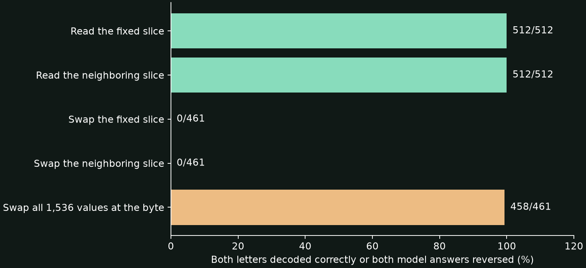

# The fixed slice encoded the Python identifier, and swapping it alone changed zero complete answers

A linear readout correctly identified both declaration letters in **512 of 512** fresh Python program pairs from the protected 192 values at the exit of block 2. It did the same from the adjacent 192 working values. Exchanging either slice between programs at that single declaration position reversed zero complete answers. Exchanging the whole 1,536-value state at the same position reversed **458 of the 461** initially solved pairs. The early fixed slice contained the distinguishing information, while the model’s own answer did not follow a swap of that slice alone.

## Detect the letter, then change the state the model receives

Each program defines a variable, runs identical intervening assignments and returns that variable. Within each pair the declaration differs in one letter, and both return prompts omit the matching last letter. All completed functions execute and return seven. The frozen 285M checkpoint is the seed-101 model trained on package-disjoint CPython at peak learning rate 0.0004 / 3 for 16,384 updates. Its last 192 residual values remain fixed from block 2 through block 9. The working comparison uses the nearest 192 coordinates. The earlier wide exchange applied just before the final block and found little effect from the protected copy. The present exchange happens when the copy is first created and before the following eight blocks. [Held-out checkpoint study](../large_study/held_out/README.md) · [Registered source intervention](../REFERENCE_ORIGIN.md)

Fit a ridge readout from the activation vector at the changed declaration byte to 26 letter scores. Use 1,024 synthetic calibration pairs (indices 16000–17023) and independently fit the two same-size readouts. The intercept follows the class mean. The ridge penalty equals 0.02 times mean feature energy after centering. Evaluate on 512 new pairs (indices 18000–18511). A readout solves the pair when both members get a higher score for their own letter than for the partner’s letter. It sees the state at the byte that contains the letter. Perfect decoding here can reflect direct token information and requires no long-range retrieval. [Generator](../exchange.py) · [Readouts and intervention](../reference_origin.py)

For the causal test, swap the reference, neighboring slice, or complete vector at that position before block 3. Resume each input through all eight remaining frozen blocks. A reversal requires both completions to prefer the other member’s letter after both originally preferred their own. Copying the complete state at every position reproduces the partner’s logits exactly and reverses all 461 originally correct pairs.

| Fresh-panel measurement | Two-member outcomes |
|---|---:|
| Reference readout, two-candidate decoding | 512 / 512 |
| Neighbor readout, two-candidate decoding | 512 / 512 |
| Single-position protected-slice swap, answer reversals | 0 / 461 |
| Single-position neighboring-slice swap, answer reversals | 0 / 461 |
| Single-position full-vector swap, answer reversals | 458 / 461 |
| Entire layer state swap, answer reversals | 461 / 461 |

The protected slice meets the registered criterion for a readable representation with little effect on the model’s answer under this intervention. The adjacent slice gives the same result. The whole-site effect means the destination computation can carry an edit from this byte onward. A single slice can fail because the answer depends on other channels, because the model uses redundant traces, or because a partial swap is inconsistent with the rest of the state. Partial swaps that leave the winner unchanged can still shift probabilities. This test measures one checkpoint and synthetic task. [Margins, fitted readouts and receipt](../results/large-reference-origin) · [Independent verification](verify.py)

The owner proposed forward references and their evaluation at scale. OpenAI Codex implemented and ran the interventions on the owner’s Apple M5 Ultra, verified the evidence and assisted with writing. [Recorded runtime](../../runtime.json)

[Pubroot submission and review](https://github.com/buildngrowsv/pubroot-website/issues/417)
