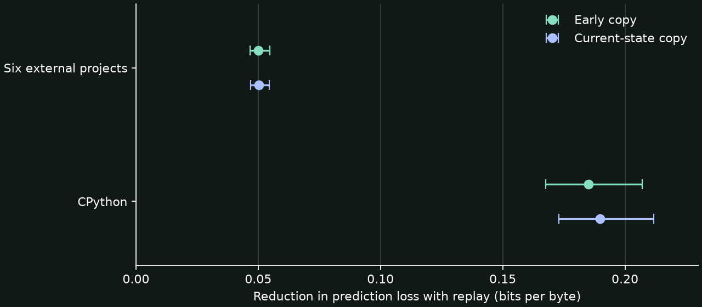

# A compact Python predictor gains from replay with either an early or a late copy

A 26.83M-parameter Python model that reads only its current working state improved on all six external projects when one in eight adaptation batches came from its original CPython training data. Compared with ordinary adaptation, this reduced external loss by 0.05030 bits per byte and CPython loss by 0.18973 bits per byte. A model of the same size that preserved 64 early values had gained 0.05010 and 0.18499 respectively under the same intervention. The early signal was therefore unnecessary for these two gains on this training draw.

## The experiment that distinguishes the explanations

The earlier experiment left two possible contributors intertwined. The model carried 64 coordinates forward unchanged across seven blocks, and it saw a mix of old and new data. The decisive fourth arm applies the same data intervention to a model whose final block takes those 64 coordinates from the current state. The entrance, middle width, exit, and number of stored weights are identical. Within each architecture, the ordinary and replay runs start from the same checkpoint after 16,384 pretraining steps. Within each pair we replaced 1,024 of 8,192 adaptation batches while keeping the other 7,168 batches identical. Each training run used 67,108,864 context bytes, including repeat exposures. [Registered control](../REHEARSAL.md) · [Architecture definition](../WORKING_EXIT.md) · [Earlier replay study](../rehearsal_study/README.md)

| Source of 64 exit values | Adaptation batches | External bits per byte | CPython bits per byte |
|---|---|---:|---:|
| Early block | All new | 1.39958 | 1.22997 |
| Early block | One in eight original | 1.34948 | 1.04498 |
| Current block | All new | 1.39516 | 1.23247 |
| Current block | One in eight original | 1.34486 | 1.04274 |

The adaptation projects were NumPy, SciPy and Matplotlib. The six external evaluation projects were pandas, NetworkX, xarray, seaborn, mpmath and joblib, each with 512 fixed windows. The original-domain panel included 2,048 windows across 49 CPython package groups. A lower value means the model assigned higher probability to the actual next byte. The paired 95% intervals for replay minus ordinary adaptation in the current-state model were −0.05455 to −0.04689 on external projects and −0.21177 to −0.17289 on CPython. Both endpoints passed the declared criterion. [Ordinary-adaptation scores](../results/ecosystem-working) · [Replay scores and Studio receipt](../results/working-rehearsal)

## How much did the effect change?

Subtracting the early-copy replay effect from the current-state effect gave −0.00020 bits per byte on external projects (95% interval −0.00323 to +0.00268) and −0.00475 on CPython (−0.01009 to +0.00025). Both intervals include zero. The intervals resample files within each fixed external project or packages within CPython. Each architecture has its own pretrained checkpoint and only one adaptation order. The test supports replay in both models. Establishing that the effect size is equivalent across architectures or training seeds would require a specified equivalence margin and independent training runs. The working comparison was chosen after the early-copy result. [Independent reconstruction](verify.py) · [Numerical contrasts](audit.json)

Old-data replay has precedent in continued language-model training. Here the intervention isolates whether our earlier benefit required transporting the early state. The owner proposed the underlying forward-reference research. OpenAI Codex implemented and ran the comparisons on the owner's Apple M5 Ultra and assisted with verification and writing. [Ibrahim et al.](https://arxiv.org/abs/2403.08763) · [Run environment](../../runtime.json)

[Pubroot submission and review](https://github.com/buildngrowsv/pubroot-website/issues/401)
