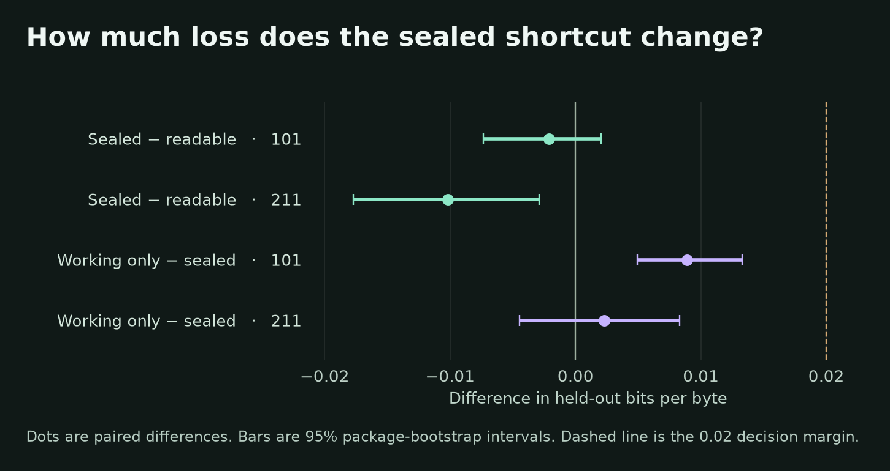

# A sealed 64-channel shortcut preserves Python byte prediction with fewer parameters

A transformer that carried 64 early values around seven narrower blocks used 26.83M parameters, 16.13% fewer than its full-width reference. It met a prespecified 0.02 bits-per-byte loss margin on held-out CPython for two training orders. An equally compact model that filled those exit coordinates from its final working state also came within 0.02 bits per byte of the sealed model on both orders. The early copy improved the point estimates by 0.00888 and 0.00226 bits per byte. Only the first package-paired interval excluded zero. Exchanging the sealed copy at the defining byte of a variable reversed zero paired identifier predictions on either seed. Most of the parameter-saving result survived removing the early copy in this design.

## Three models with the same update budget

The readable baseline has ten blocks of width 512. Seven middle blocks can read a protected 64-channel slice but cannot overwrite it. In the sealed version, the first two blocks produce a working state of 448 coordinates and a 64-coordinate reference. Only the 448 working coordinates pass through the seven middle blocks. At block 10 the unchanged early reference rejoins the working stream. Both compact versions store 26,830,464 parameters, versus 31,992,320 in the baseline. The working-only comparator fills the final 64 slots with a duplicate of its last 64 working features. It shares the sealed model’s architecture, trainable tensors, initialization and update budget. Duplication reduces the rank of the final input. This limits how precisely the comparison can attribute a small advantage to distance traveled. Identity shortcuts in deep networks have an extensive history. The question here concerns an isolated per-token slice and a narrower middle network. [Architecture](../BYPASS.md) · [Equal-size control](../WORKING_EXIT.md) · [He and colleagues, ECCV 2016](https://arxiv.org/abs/1603.05027)

Each fit used AdamW for 16,384 updates of 8,192 context bytes, totaling 134,217,728 training bytes including repeat exposures. The two seeds changed initialization and training order. All arms on a seed saw identical training batches. Package-group splits of a pinned CPython archive separate 1,273 training files from 140 validation and 70 test files. All fits used the same 2,048 test windows drawn from 49 package groups. Windows may overlap and code fragments may recur across groups. Grouped 95% bootstrap intervals quantify package variation for each fit. The two seeds share the test material. [Corpus manifest](../results/main/corpus.json) · [Second-order protocol](../BYPASS_REPEAT.md)

| Training seed | Full readable | Sealed | Working only | Working only minus sealed, 95% interval |
|---|---:|---:|---:|---:|
| 101 | 1.02012 | 1.01799 | 1.02687 | +0.00888 [0.00490, 0.01330] |
| 211 | 1.03041 | 1.02023 | 1.02250 | +0.00226 [−0.00445, 0.00828] |

Lower bits per byte is better. The sealed-minus-readable intervals were [−0.00736, +0.00202] and [−0.01772, −0.00290]. Both upper bounds met the 0.02 resource margin, and both compact controls were within the separately declared 0.02 working-only margin. The second-order training times were 570 seconds sealed, 601 seconds readable and 625 seconds working-only on one Studio with checkpoints every 64 updates. The timing was observational. Final byte accuracies, per-window data and validation contrasts are released alongside the loss results. [Paired audit for all fits](audit.json) · [Second-order compact control](../results/working-repeat/result.json)

## Can the defining byte’s early copy switch an identifier?

We froze both sealed models and generated 1,024 new pairs of executable functions. In each pair the variable definition differed by one byte, and the return line requested the corresponding completion. We exchanged just the defining byte’s 64 early coordinates immediately before block 10. Both programs initially ranked their respective correct completion over its partner in 951 pairs on seed 101 and 949 on seed 211. The early-coordinate swap produced zero double reversals on either seed. An equally wide adjacent slice in the working stream also produced zero. Swapping the entire state at that same byte produced 74 and 267 double reversals, including 18 and 71 exact partner completions among pairs originally correct across the full vocabulary. Swapping all states reproduced the partner predictions exactly. The test establishes sensitivity to that position using the full state. It leaves open smaller effects on margins, distributed routes and other source positions. These generated identifier prompts were separate from the corpus loss measurement. [Intervention protocol](../SEALED_EXCHANGE.md) · [Per-pair records](../results/sealed-exchange) · [Audit](exchange-audit.json)

The research question came from the account owner’s proposal for forward-only protected references. OpenAI Codex implemented and operated the Studio experiments and assisted with the analysis and writing. The public NumPy audits recompute loss from the saved byte windows, check their package and window identities across arms, and reaggregate the intervention outcomes. A further registered control used the magnitudes of the same 64 final working features, preserving the input norm and adding no parameters. On seed 101 it scored 1.02074 bits per byte. This improved on duplication by 0.00613 (paired 95% interval for magnitude minus duplicate −0.01089 to −0.00213). Its loss relative to the early copy was +0.00275 [−0.00149, +0.00673]. The upper bound exceeded the 0.005 equivalence margin and the lower bound fell below it, leaving the mechanism unresolved under the registered rule. The feature-map series closes here. [Verified follow-up scores](../results/magnitude/audit.json) [Score audit script](verify.py) · [Identifier audit script](verify_exchange.py) · [Subsequent control protocol](../MAGNITUDE_EXIT.md)

[Published Pubroot paper](https://pubroot.com/ai/fine-tuning/a-sealed-64-channel-shortcut-preserves-python-byte-prediction-with-fewer-parameters/) · [Public review](https://github.com/buildngrowsv/pubroot-website/issues/374)
