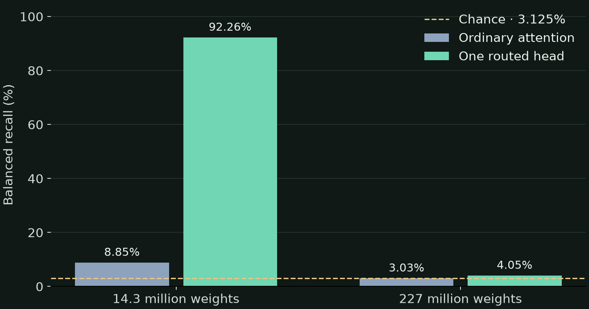

# A single routed memory head loses most of its short-budget advantage in a 227M-parameter transformer

A route that lifted register recall from 8.85% to 92.26% in a 14.3M-parameter transformer lifted recall from 3.03% to 4.05% in a 227M-parameter transformer. Both sizes received the same 512 updates on identical programs. Chance was 3.125%. A second experiment placed a previously successful 261,248-weight donor into the wider host and trained only the following block. Of 333 queries newly solved relative to the adapted native control, just four became incorrect when the donor was removed. The short-budget runs establish a sharp limit on transfer of the small-model result under this training recipe.

## What the models had to remember

Each program has 16 registers and 32 possible values. A program initializes the registers, overwrites some, and asks for their original or current contents. We scored 5,325 original-value and 5,409 current-value queries about overwritten registers in the same 1,024 held-out programs. Balanced recall gives equal weight to the two types of question. In block 4 of eight, one 64-coordinate attention head could read positions displaced by one event from the matching register writes. Ordinary attention was the paired control. Width increased from 384 to 1,536, with the designated head occupying one of six or one of 24 heads respectively. Both sizes saw 4,194,304 training tokens per arm with one coupled random seed. Comparing widths changes capacity, compute per token and the fraction of heads given the routing signal. [Registered design](../LARGE_REVISIT.md) · [Original result and intervention](../relay_study/README.md)

| Learned parameters | Ordinary attention | One routed head | Difference |
|---|---:|---:|---:|
| 14,293,632 | 8.85% | 92.26% | +83.41 points |
| 227,043,840 | 3.03% | 4.05% | +1.02 points |

The routed advantage shrank by 82.39 points (95% paired program-bootstrap interval 81.42–83.35). The wider model's advantage was 1.02 points (0.45–1.63). The intervals quantify test-program sampling for these fits. In a second panel of 1,024 counterfactual pairs, the wider routed model got both initial answers correct in only one pair. The small model had qualified on 1,014. The large model provided too few correct pairs to interpret its internal value-exchange test. [Per-program counts, paired answers and execution receipt](../results/large-width) · [Independent reconstruction](verify.py)

## Could the wider host learn to use an expert that already knows this task?

The frozen donor had previously produced 90.29% balanced recall inside the trained 14.3M hybrid. It outputs a 64-value vector for each token. In the 227M host we spliced that vector into block 4 and updated only the 28,314,624 parameters in block 5. A native-head control and an equally large donor trained on shuffled targets received the same 1,024 adaptation batches. All three used the host's own output projection. The smaller working hybrid had inherited donor output columns. This cross-width transfer therefore tests a different interface as well as a larger recipient. [Earlier donor study](../recipient_study/README.md) · [Large-recipient protocol](../LARGE_RECIPIENT.md)

| Configuration | Balanced recall |
|---|---:|
| Aligned donor, before host adaptation | 2.63% |
| Adapted native control | 5.12% |
| Adapted shuffled-donor control | 5.73% |
| Adapted aligned donor | 5.45% |
| Same adapted aligned host, native head restored | 5.51% |

Across 10,938 held-out queries, the graft newly solved 333 queries relative to the adapted native control and lost 297 that the native control had solved. Restoring the native head in the trained graft erased four of those 333 new answers. Across all queries, removal erased six correct answers and rescued 13 errors. The aligned-minus-removal balanced difference was −0.064 points (paired 95% interval −0.154 to +0.018). On this panel the trained recipient showed little behavioral dependence on the donor. [Per-query predictions](../results/large-recipient/queries.npy) · [Graft audit](verify_graft.py)

## Training stability and scope

Continuing the dense 227M checkpoint at the original learning rate, 0.00045, produced nonfinite loss before the 4,096-update target. The last recorded finite loss was at update 624. Retrying from the saved 512-update checkpoint again stopped at the finite-loss check. This limits any inference about what a well-trained wide model can learn. A follow-up continues both original checkpoints with a fourfold lower learning rate and finishes the missing original-rate routed arm separately. [Failure receipt and log](../results/large-budget-failure) · [Follow-up protocol](../LARGE_REVISIT.md)

The owner proposed the scale revisit. OpenAI Codex implemented the experiments, operated the owner's Mac Studio over SSH, checked the released counts and assisted with writing. Run both verification scripts in this directory with Python and NumPy to reproduce the comparisons. [Width audit](audit.json) · [Graft audit counts](graft-audit.json)

[Pubroot submission and review](https://github.com/buildngrowsv/pubroot-website/issues/384)
