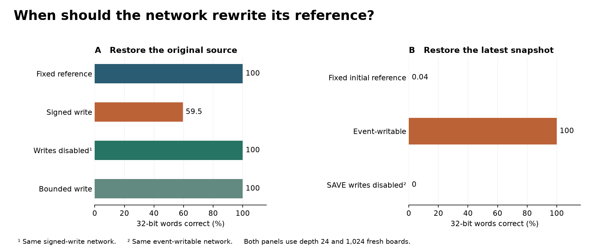

# When should a spatial network rewrite its reference?

A learned network carried a 32-bit word through 24 layers and recovered a saved intermediate value exactly on **27,016 of 27,016** cells whose answer depended on a write. Suppressing only the write attached to SAVE in the same trained model dropped that count to **zero** for each of three seeds. When the task instead called for the original value throughout, both a read-only reference and a writable reference with bounded updates achieved 100%. These experiments separate stability during transport from the ability to capture a new source.

## A route through space and depth

Each layer is a two-dimensional grid with wraparound edges. A cell starts with 32 independent random signed bits. At each depth a local command asks the cell to preserve its working vector, read from one of four neighbors, or restore its reference. Its trainable read table has six command rows and six possible source ports. A row-wise softmax mixes those ports. The same weights apply at every location and depth. A prediction passes only if all 32 signs match the independent command interpreter. An 8-by-6-by-6 stack has 288 locations. This is a spatial grid evolving with depth, with local communication confined to each transition. It is a small test of a memory mechanism.

We trained from scratch on side-six grids for eight transitions, with random commands, 24 fresh boards per update, 400 updates, Adam at 0.065, final-board bitwise logistic loss with logit scale five, and three paired seeds (101, 211, 307). There was no supervision of individual reads or write gates. The fixed and late-only models have 36 learned read weights. The writable models add six command-specific gates initially set to zero. The primary metric uses cells where deleting intermediate restores changes the source index, excluding final restore commands. We evaluate paired boards at the training shape, at three times the depth, and at side ten. The independent port interpreter specifies all labels. [Initial plan](PLAN.md) · [Model and generator](run.py)

## The apparent advantage of a protected channel

At depth eight, fixed and writable references both achieved 100% whole-word accuracy on the restore-dependent cells. With the same weights at depth 24 the fixed reference achieved 100%, and the signed writable rule averaged 59.12%. The difference was 40.88 percentage points with a paired 95% interval of [38.88, 42.91] across 256 boards and three seeds. Both models again reached 100% on the wider grid at depth eight. A reference readable only in the final layer scored 0.03% at depth 24. Swapping the fixed source bank between boards erased all correct full words on the primary subset. Discretizing the writable network's learned read decisions left its long-depth errors in place.

The signed rule updates memory by adding a fraction of the displacement from memory to working state. Its fraction can be negative, moving memory away from the working value. Learned movement-command gates did take negative values. The follow-up replaced this rule with a conventional convex interpolation, projecting each gate to [0,1] after every optimizer step. On 1,024 fresh depth-24 boards with 29,082 qualifying cells, the original signed model averaged **59.51% whole-word accuracy** despite **97.26% bit accuracy**. Bounded writable and fixed memory each achieved 100%. Setting all writes to zero in the previously trained signed model also restored 100%. The instability arose from this write rule under repeated computation. The evidence gives no general advantage to immutable storage over stable writable storage. [Intervention plan](FOLLOWUP.md) · [Per-board results](results/summary.json)

## A wall, a doorway, and a later source

We added a wall across both seams separating two halves of the toroidal grid. The wiring permits a neighbor read across one seam at exactly one coordinate when a doorway is open. A blocked move keeps the cell's working value. On 1,433 cells whose required word changed between an open and a sealed doorway, the trained fixed router produced the correct word in both topologies for every seed. Running with unrestricted connections on the open-door inputs got 889/1,433 correct. The experiment tests a learned local rule operating with externally imposed geometry. The location of the wall was supplied. [Counterfactual implementation](interventions.py)

The final task adds a seventh command. SAVE keeps the working value and records it for a future RESTORE at that cell. A new 7-by-6 read table can learn that SAVE should read the current working value. A seven-entry convex write gate can learn which command requires updating the memory. We used the same budget and three fresh paired training streams. In every fit the gate reached one on SAVE and zero on each of the other six commands. On the 27,016 save-dependent cells of 1,024 fresh boards at depth 24, the event-writable model recovered every whole word. The fixed-initial-reference model averaged 0.04%. Suppressing the SAVE gate alone in the trained writable model erased every correct word on this subset. These counts refer to a common evaluation panel across seeds. [Snapshot plan](SNAPSHOT.md) · [Learned gates and interventions](snapshot.py)

## Interpretation and reproduction

Shared local update rules have precedents in neural cellular automata. Neural algorithm execution studies test whether such local rules can generalize across problem sizes. Differentiable external memory and learned write controls also have a substantial history. This experiment measures the consequences of three specific write policies, at matched depths and under a direct intervention, on an explicitly command-driven task. [Growing Neural Cellular Automata](https://distill.pub/2020/growing-ca/) · [Neural Execution of Graph Algorithms](https://arxiv.org/abs/1910.10593) · [Neural Turing Machines](https://arxiv.org/abs/1410.5401)

The commands, candidate routes and memory slot are supplied by the architecture. Success does not establish that a model can independently discover when remembering is useful in natural data. The next discriminating test removes the explicit SAVE token and makes the usefulness of a snapshot depend on information distributed across nearby cells.

Use Python 3.12 with MLX 0.32.4 and NumPy 2.5.5 on Apple Silicon. Run run.py, interventions.py, and snapshot.py in that order from this directory. The CPU-only report.py aggregates counts and resamples whole boards and paired seeds in 5,000 draws. The saved read tables and gates allow replay. Figure generation uses Matplotlib. The account owner proposed spatial walls and forward references to earlier computation. OpenAI Codex implemented, ran and analyzed this experiment over SSH on the owner's Mac Studio and assisted with the writing. [Pinned code and evidence](https://github.com/buildngrowsv/fixed-reference-benchmark/tree/7e4f5c76a61234558191097cf43bffb1006d073b/spatial_references)
