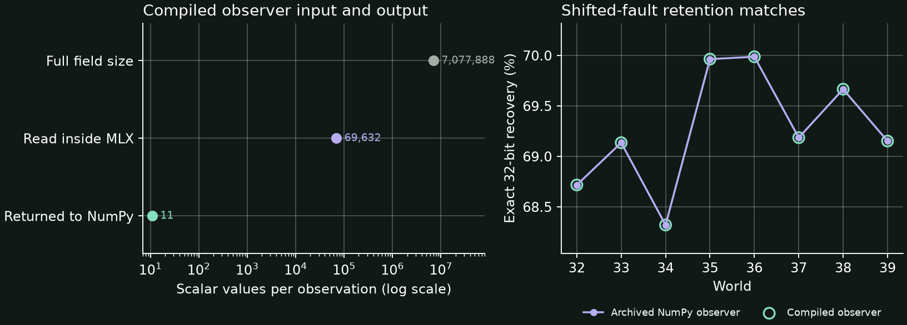

# A compiled observer preserved every recorded outcome on a 7.08-million-cell grid

Moving the boundary and witness decisions into a compiled MLX observer reproduced **all 4,608 recorded simulation tallies and all 1,536 archived offset coordinates** across eight paired 192³ worlds at one frozen checkpoint. The observer returned **11 scalar values per call**. It evaluated the same 69,632 detector readings inside MLX and produced 512 decision vectors across the run. The fixed and supplied-position control arms continued to materialize dense detector fields.

## Keep the observer calculations in MLX

The memory grid has a learned local detector, working word transport and a confirmation witness eight cells away. A previous benchmark selected region boundaries and witness axes using at most 0.984% of the detector field. The direct-sampling timing benchmark evaluated the same two statistics in NumPy after their respective MLX gathers. This comparison keeps the two gathers, boundary search, regional index construction and co-activation calculation in a compiled MLX function. [Sparse recovery experiment](../anchored_witness_scale_study/README.md) · [Direct-read timing](../device_witness_timing_study/README.md)

The compiled function compares neighboring samples along 64 stratified lines per axis and maximizes the sum of disagreement counts at the paired boundaries. It then translates 1,024 precomputed points per region and their three axial neighbors into the inferred partition. It counts joint activation and takes the minimum across axes, using the same tie rule. The caller receives three offsets and eight axis selections. The sample count is an upper bound on entries read by the statistic, with any duplicate coordinates included. [Pinned compiled observer and evaluation runner](https://github.com/buildngrowsv/fixed-reference-benchmark/blob/9dad3fd31226a763be3c11ae00c4453a30522463/spatial_references/compiled_witness_parity.py)

## Validate outcomes in the recurrent comparison

Reuse the eight worlds and checkpoint 101 from the archived 192³ dedicated-sampling run. Initial words, true writes, movements, detector weights and fault masks are paired. At both routing ticks in each of 16 rounds, compute the 11-value output for each aligned and shifted layout. The inferred arm uses the compiled offsets and axis choices to construct its witness. The fixed and true-position policies still use their previous dense routing paths for comparison. [Registered parity comparison](../COMPILED_WITNESS_PARITY.md) · [Frozen checkpoint weights](../results/cube-full-101.json)

The 4,608 recorded tallies include the sampled, fixed and supplied-location arms, both layouts, eight worlds, 16 rounds and six counts per arm. The 1,536 archived offset coordinates include estimated and true offsets in all worlds and rounds. The verifier checked equality to the paired archived arrays, and checked that the exported offsets on the second decision tick match the stored inference coordinates. This establishes exact agreement on all recorded outcomes in the selected checkpoint and worlds. The earlier full-simulation archive contains boundary offsets and aggregate counts. The 512 compiled vectors additionally record individual axis choices for this new run. The full comparison still stages dense control tensors, so end-to-end latency remains outside the result. [New parity and decision archive](results/parity.npz) · [Matched original archive](../anchored_witness_scale_study/results/worlds.npz) · [Verified counts](audit.json)

Run `uv run --with numpy python spatial_references/compiled_witness_parity_study/verify.py` to verify data shapes, checkpoint and archive hashes, and exact parity. The Studio run took 602 seconds at 14.33 GB peak MLX allocation. The environment capture records an arm64 Apple M5 Ultra with 256 GiB unified memory, macOS build 26B118, Python 3.12.16, MLX 0.32.4 and NumPy 2.5.5. The owner proposed the spatial memory research. OpenAI Codex implemented, ran, verified and documented the comparison. [Independent verifier](verify.py) · [Execution receipt](results/receipt.json) · [Studio environment capture](results/studio-environment.txt)
