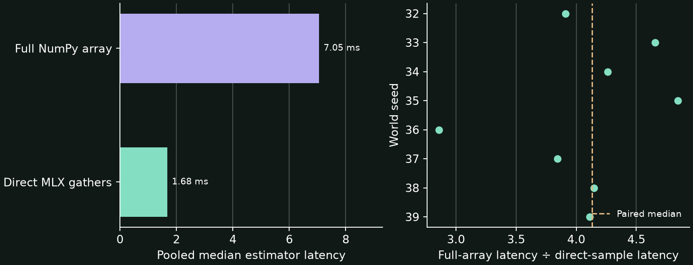

# Reading detector samples directly sped up the 7.08-million-cell estimator 4.13 times

On a 192³ detector field, two MLX gathers sped up the paired boundary-and-witness estimator **4.13×** (95% world-paired interval 3.84× to 4.66×) compared with materializing the full detector field to NumPy. Pooled median latency was **7.05 ms versus 1.68 ms**. All three boundary coordinates and eight selected witness axes matched exactly in **48 of 48** frames. Both methods use the same learned detector and the same decision statistic.

## Compare how the same estimator reads its input

The task estimates boundaries and selects confirmation directions for a simulated grid with correlated false writes. The validated policy reads 64 stratified lines per axis to find periodic region boundaries, then samples 1,024 base sites and three axial neighbors per region. The larger retention benchmark measured the effect of this observation budget. This experiment holds the observation rule fixed and times two paths beginning from an evaluated MLX detector tensor. [Sparse retention benchmark](../anchored_witness_scale_study/README.md) · [Registered timing comparison](../DEVICE_WITNESS_TIMING.md)

The baseline converts all 7,077,888 detector values into a NumPy array and indexes the selected locations there. The direct path gathers 36,864 line readings from the MLX tensor. The estimator infers the boundaries on those observations, constructs the resulting regional point indices and gathers at most 32,768 more readings. Only those arrays enter NumPy. Both use the same co-activation ratio, offsets and minimum-axis tie rule. Dense frame construction and fixed line-index preparation are outside the timer. The timed interval includes synchronization for the samples and regional index construction. On unified memory these are counts of observed scalar values and latency of the path to the resulting decision. [Pinned implementation](https://github.com/buildngrowsv/fixed-reference-benchmark/blob/1b375f271a66ad1307b40511acd1cf5fd8568be8/spatial_references/device_witness_timing.py)

The 48 frames cross eight world seeds and three frozen detectors with aligned and shifted faults. Each arm warms once per frame, then runs 12 times with alternating order. Prespecified success required exact equality, a median world speed ratio of at least 1.25× and a lower paired bound above one. Calculate each frame's ratio from its repeated medians. Calculate each world's median ratio across layouts and detectors and bootstrap eight complete worlds with 5,000 draws. The lowest individual frame ratio was 2.72×. [Archived frame decisions and repetition timings](results/timings.npz) · [Computed metrics](audit.json)

The result covers the isolated selector on synthetic detector frames. The parent simulation also updates learned transport, writes and readout over the full volume. Those operations remain outside this timing result. Run `uv run --with numpy python spatial_references/device_witness_timing_study/verify.py` to verify all decision vectors and reconstruct the reported latency and world-paired interval. Hardware was an arm64 Apple M5 Ultra with 256 GiB unified memory. The linked Studio capture records the exact operating system build and the Python 3.12.16, MLX 0.32.4 and NumPy 2.5.5 versions. The owner proposed the sparse observation work, and OpenAI Codex implemented, ran, audited and documented this timing comparison. [Execution receipt](results/receipt.json) · [Direct environment capture](results/studio-environment.txt) · [Independent verifier](verify.py)

[Published Pubroot article](https://pubroot.com/se/performance/reading-detector-samples-directly-sped-up-the-7-08-million-cell-estimator-4-13-times/) · [Review](https://github.com/buildngrowsv/pubroot-website/issues/527) · [Compiled observer parity protocol](../COMPILED_WITNESS_PARITY.md)
