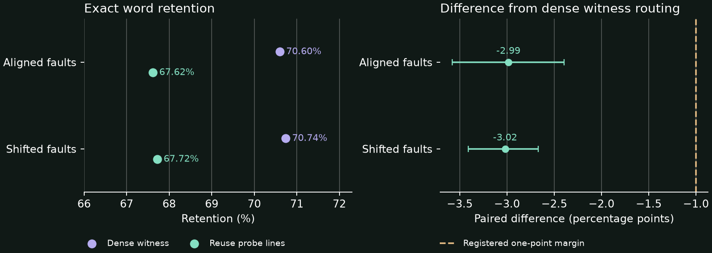

# Reusing boundary probes for witness routing cost three retention points

On an 884,736-cell grid, using the same stratified lines for both boundary detection and regional witness selection reduced shifted-fault word retention from **70.74% to 67.72%**. Boundary estimates matched exactly, and all conditions accepted 99.00% of legitimate writes. The penalty was **3.02 percentage points** (paired 95% interval 2.67 to 3.41 points), outside the registered one-point margin. The larger replication was skipped under its precommitted condition.

## Hold the boundary estimates fixed

Each cell on a periodic 96³ lattice has a working 32-bit word and a saved word. A frozen detector uses local and neighboring readings, and a saved update needs two consecutive positive detector ticks and confirmation from a witness eight cells away. Infer the translation of eight periodic 48³ regions from the previous detector field. For each axis, the boundary estimate maximizes the sum of disagreement rates across two candidate planes separated by 48 cells. Both arms use the same 64 stratified detector lines per axis for this estimate. Those three sets of lines use at most 2.08% of the field. Each arm wraps an eight-cell comparison inside the inferred region. [Boundary experiment](../stratified_regions_study/README.md) · [Registered witness-routing protocol](../SAMPLED_WITNESS_ROUTING.md)

The existing policy chooses the witness axis with the lowest detector co-activation over all cells in each inferred region. The new arm estimates that ratio only from the same detector lines that set the boundaries. For each region and candidate axis, group the sampled readings by their inferred region and count sampled pairs eight axial cells apart whose two detector values are both positive. Divide by the number of sampled pairs there, and choose the lowest co-activation rate. The same detector readings provide both ends of each comparison along its line. The fixed and true-boundary policies retain the original dense axis selection and are matched controls. The simulator stages the dense detector field for its comparison arms. This benchmark measures the information budget of the sampled policy. [Pinned runner](https://github.com/buildngrowsv/fixed-reference-benchmark/blob/5ef2af27507aa921f79c95a22bef7dcee670ccb0/spatial_references/sampled_witness_routing.py)

### Paired responses

All arms use eight paired world seeds, three frozen transport and detector checkpoints, and the same word initialization, command stream, true writes and false pulses. The run counts exact 32-bit recovery over the latter eight of 16 rounds. Each round contains 16 updates. Paired intervals resample whole worlds and retain all rounds and checkpoints from each sampled world.

| Inference and witness rule | Aligned word retention | Shifted word retention | Shifted false writes |
|---|---:|---:|---:|
| Fixed regions, dense witness rule | 72.56% | 65.24% | 7.69% |
| Stratified boundaries, dense witness rule | 70.60% | 70.74% | 5.71% |
| Stratified boundaries, reuse lines for witness rule | 67.62% | 67.72% | 6.40% |
| True region boundaries, dense witness rule | 72.56% | 72.55% | 5.27% |

The sampled-minus-dense effect was −2.99 points in aligned worlds (−3.58 to −2.39) and −3.02 in shifted worlds (−3.41 to −2.67). The new arm's shifted advantage over fixed boundaries was +2.48 points (+0.63 to +4.44), below the four-point practical threshold. Legitimate-write acceptance met its registered floor in both layouts. The verified paired arrays agree exactly on every boundary estimate and all fixed and known-control counts. This isolates the performance loss to replacing the witness statistic under the given measurement budget. It does not identify the ideal sparse placement or demonstrate lower device traffic. [Sampled counts and offsets](results/worlds.npz) · [Dense counts and offsets](../stratified_regions_study/results/worlds.npz) · [Paired audit](audit.json)

Run `uv run --with numpy python spatial_references/sampled_witness_study/verify.py` to verify the matched archives and recompute counts and intervals. The run took 144 seconds at 1.79 GB peak MLX allocation on Apple M5 Ultra with 80 GPU cores and 256 GiB unified memory, macOS 27.2, Python 3.12.16, MLX 0.32.4 in float32, and NumPy 2.5.5. The owner proposed the spatial benchmark. OpenAI Codex implemented, ran, audited and wrote up the comparison. [Execution receipt](results/receipt.json) · [Independent verifier](verify.py) · [Dedicated regional samples follow-up](../ANCHORED_WITNESS_ROUTING.md)

[Pubroot review declined](https://github.com/buildngrowsv/pubroot-website/issues/516) · [Expanded dedicated-sampling comparison](../anchored_witness_study/README.md)
