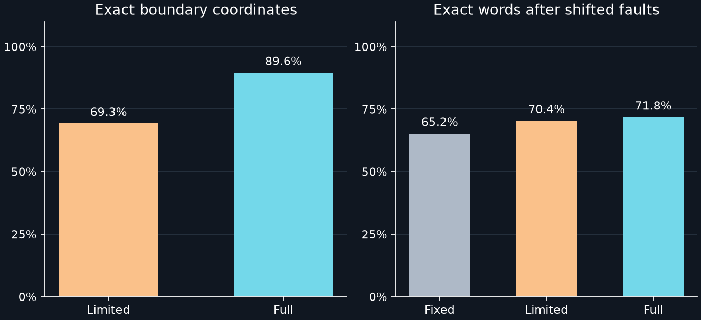

# Limited observations retained most of the shifted-boundary benefit

Sampling at most **2.08%** of the detector field to locate the boundary planes recovered **70.36%** of words after shifted faults. Full-field inference recovered **71.78%**, and fixed boundaries recovered **65.24%**. The sampled method preserved a measurable gain over fixed regions. Its lower paired bound against full observation crossed the registered noninferiority margin.

Each replay uses the same eight paired worlds on a 96³ grid, 256 transitions, 32-bit words and three frozen checkpoints. The original estimator compares each voxel across the neighboring planes. The sampled estimator selects 64 lateral coordinates per axis once per world and compares the detector readings along those same columns at every candidate plane. From both estimates it chooses the periodic pair of planes with the largest total mismatch. The sampling alters only the location statistic. Candidate witness routing inside each inferred region still uses full regional co-activation. All legitimation and memory rules stay unchanged. [Preregistration](../SPARSE_REGIONS.md) · [Full observation baseline](../inferred_regions_study/README.md) · [Sampler implementation](../inferred_regions.py)

| Method | Exact shifted boundary coordinates | Exact words after shifted faults | Legitimate writes accepted |
|---|---:|---:|---:|
| Fixed boundaries | — | 65.24% | 99.00% |
| Sampled boundary inference | 69.27% | 70.36% | 99.00% |
| Full-field boundary inference | 89.58% | 71.78% | 99.00% |
| Given correct boundaries | — | 72.55% | 99.00% |

The sampled rule gained **5.12 points** over fixed boundaries on translated faults, paired 95% interval **3.23 to 7.08**. Its loss relative to full observation was **1.43 points**, paired interval **−2.17 to −0.80**. The lower bound missed the required −2-point margin. Fixed and supplied-boundary controls agreed exactly with their previously archived counts on every matching world and round. The observed loss is smaller for the storage outcome than for exact boundary recovery. This test measures requirements of the boundary statistic. The instrumentation keeps full tensor copies and reports no memory-transfer or wall-clock speed improvement. [Model receipts and raw worlds](results) · [Independent paired audit](audit.json)

Run `uv run --with numpy python spatial_references/sparse_regions_study/verify.py` from the repository root to check the checkpoint hashes, paired offsets, exact controls and bootstrap. The test ran float32 state updates on an Apple M5 Ultra with 80 GPU cores, 256 GiB memory, Metal 4, macOS 27.2, Python 3.12.16, MLX 0.32.4 and NumPy 2.5.5. The owner proposed exploring spatially structured fixed references. OpenAI Codex implemented and ran the paired test, audited the results and assisted with writing. [Pinned receipt](results/receipt.json)
