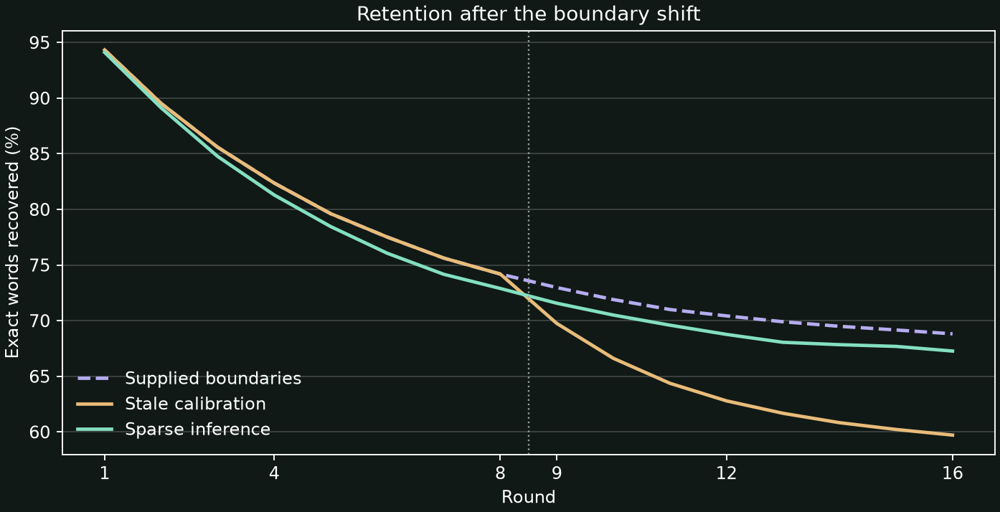

# Sparse observations recovered 5.66 points after an abrupt 3D boundary shift

A detector that sampled at most **0.984%** of a **192³-cell** field recovered **68.91%** of exact words after an abrupt boundary change. A matched controller that kept the old boundaries recovered **63.25%**. Supplying the true new boundaries recovered **70.46%**. The sparse estimate regained 5.66 percentage points over stale calibration (paired 95% interval +5.33 to +6.00), at the same 99.00% legitimate-write acceptance.

Eight synthetic worlds used the same previously trained local detector at checkpoint 101. Round nine translates all three partition offsets by 48 cells modulo half of the cube side. The stale controller has exact initial offsets. The supplied-location control receives exact current offsets. The inferred policy estimates boundaries from 64 lines per axis and estimates each region's witness direction from 1,024 anchors. At most 69,632 of 7,077,888 detector entries are sampled across both statistics. All arms use paired initial words, writes and faults. [Registered protocol](../WITNESS_BOUNDARY_JUMP.md) · [Implementation](../witness_boundary_jump.py) · [Frozen detector](../results/cube-full-101.json)

Across the eight rounds after the shift, the observer's 1.55-point deficit to supplied boundaries had a 95% interval of −1.88 to −1.22, within the registered two-point margin. False writes fell from 10.15% with stale boundaries to 6.21% with inference and 5.81% with supplied boundaries. The sparse policy identified 77.60% of boundary coordinates exactly. In the stationary aligned comparison, the inference policy recovered 69.22% versus 70.45% for the supplied controls. Intervals resample worlds rather than individual grid cells. [Integer tallies and offsets](results/jump.npz) · [Numeric report](results/result.json) · [Independent verifier](verify.py)

This test covers one checkpoint and one simultaneous, predetermined translation of an axis-aligned partition. The follow-up uses fresh worlds, staggered changes and a first-round recovery endpoint. The Studio run took 600 seconds, peaking at 14.33 GB of MLX allocation. Reconstruct these numbers from the archives using NumPy with `python spatial_references/witness_boundary_jump_study/verify.py` from the repo root. [Receipt](results/receipt.json) · [Environment](results/studio-environment.txt) · [Staggered-change protocol](../WITNESS_STAGGERED_JUMPS.md)

[Pubroot review, declined](https://github.com/buildngrowsv/pubroot-website/issues/539)

[Matched follow-up on staggered jumps and the first affected round](../witness_staggered_jumps_study/README.md)
