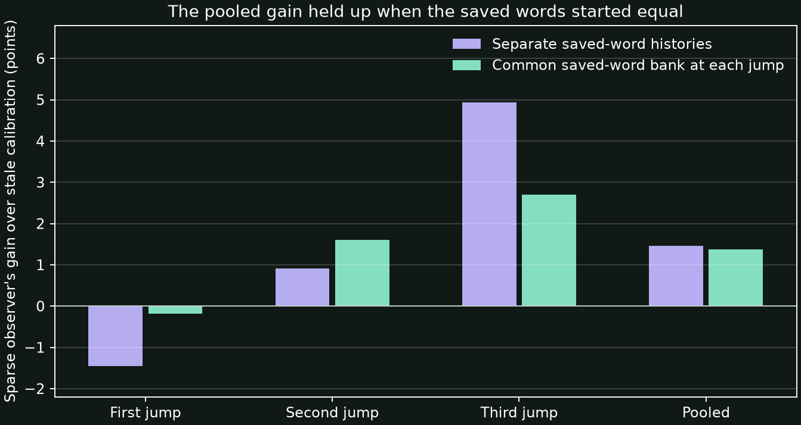

# A common saved-word bank preserved the pooled gain after staggered 3D boundary jumps

With each controller starting from the same **7.08-million-cell** saved-word bank at every jump, sparse sensing improved first-round retention over stale calibration by **1.37 percentage points**. The original comparison, in which each controller kept its own saved words, gained **1.47 points**. Their paired difference was **0.096 points** (95% interval −0.461 to +0.694), inside the registered ±1-point tolerance. Earlier writes did affect the third-jump comparison, where equalizing the saved words reduced the observed gap from 4.94 to 2.70 points.

## Isolate the retained history before the boundary moves

The periodic 192³ lattice stores a working 32-bit word and a saved 32-bit word at each cell. One learned local movement and read rule and a two-tick write detector are shared throughout the grid. The task is to retain the most recently authorized word across movements and correlated false write pulses. The data are simulated. The eight worlds, three jittered boundary jumps per world, one frozen checkpoint, exact write schedule and false-fault fields are the same as in the preceding study. [System model and staggered benchmark](../witness_staggered_jumps_study/README.md) · [Frozen weights](../results/cube-full-101.json)

The stale observer keeps its initial boundary layout. The sparse observer uses 64 lines per axis and 1,024 dedicated anchors in each of eight regions to choose boundary offsets and witness axes, reading at most 0.984% of the detector field for these decisions. The supplied-boundary arm knows the current partition. Immediately before every marked jump, the new run broadcasts that arm's saved-word bank to each policy. The working words, local detector state, inferred and true offsets, and all subsequent updates remain determined by the same commands and stimulus. Policies run autonomously until the next marked event. [Registered intervention](../WITNESS_COMMON_START.md) · [Pinned implementation](https://github.com/buildngrowsv/fixed-reference-benchmark/blob/06b0d79fea62aad422522880344f9cbfa6b1d25b/spatial_references/witness_common_start.py)

## Retention after the state intervention

| History policy | Stale calibration | Sparse sensing | Supplied bounds |
|---|---:|---:|---:|
| Each arm keeps its own saved words | 71.44% | 72.90% | 74.48% |
| Common saved-word bank at each jump | 72.86% | 74.23% | 74.48% |

All recorded supplied-position tallies, all detector offsets, all offered and accepted writes, and all false-write counts matched the original arrays. The saved-word bank intervention does not change how many writes these policies make. It changes which saved bits are present before those writes. The pooled comparison weights the 24 matched jump events equally. The confidence interval resamples complete worlds, keeping all three jumps together. The shared-bank result confirms that the modest aggregate advantage does not require the previously diverged banks in these worlds. The different third-jump comparison is descriptive and shows where the trajectories differed most. [Raw aligned tallies](results/common-start.npz) · [Numeric result](results/result.json) · [Independent reconstruction](audit.json)

The common bank follows one known-boundary policy. The experiment does not average over arbitrary shared starting states or estimate the response for other checkpoint weights. The single-run trajectories establish this controlled comparison for the tested fault family and eight worlds.

## Reproduction

The Apple M5 Ultra Studio ran macOS build 26B118, Python 3.12.16, MLX 0.32.4 in float32 and NumPy 2.5.5 with 256 GiB unified memory. This run took 601.58 seconds and peaked at 18.44 GB MLX allocation. From the public repository root, `python spatial_references/witness_common_start_study/verify.py` verifies the archived results. To rerun on Apple Silicon, install the listed libraries, link the earlier `witness_staggered_jumps_study/results` directory into a temporary queue root as `runs/spatial-witness-staggered-jumps-7077888`, and set `STUDIO_QUEUE_ROOT` to that root and `STUDIO_JOB_DIR` to a fresh results directory before running `python spatial_references/witness_common_start.py`. The owner proposed spatial reference and boundary experiments. OpenAI Codex registered, ran, audited and documented this comparison. [Execution receipt](results/receipt.json) · [Studio environment](results/studio-environment.txt) · [Verifier](verify.py)
